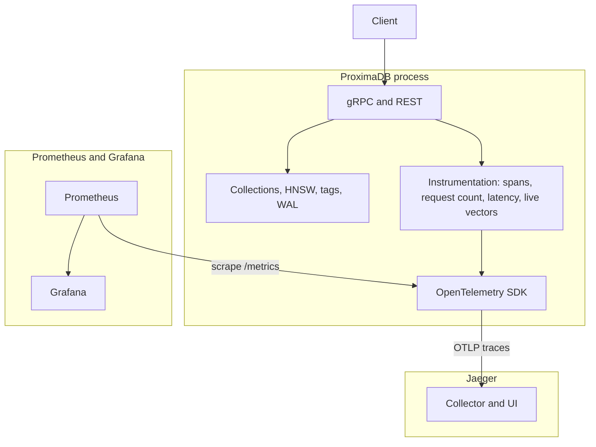

# ProximaDB

A small vector database in Go. You create named collections, insert vectors with optional tags, search by nearest neighbors, and delete by id. Data can live only in memory or on disk under a write-ahead log that replays on startup.

## What you get

- **Collections** — Each has a fixed dimension and distance metric (cosine, L2, or dot). Smaller distance means closer.
- **HNSW** — Approximate nearest-neighbor search in memory. Deletes are tombstones: ids vanish from results but stay in the graph for navigation.
- **Equality tags** — Key/value metadata on each vector. Search can filter with an AND of tag pairs, for example `color=red`.
- **Inverted index for filters** — With a filter, candidates come from a tag map first, then are ranked by exact distance. Rare tags still return `k` results. With no filter, search walks HNSW only.
- **Flat index** — Exact scan used in tests and benchmarks to measure HNSW recall.
- **Write-ahead log** — Mutations are appended to `wal.log` under `-data`, then applied in memory. Restart with the same directory rebuilds the collections.
- **Checkpoint** — In library code you can rewrite the log to drop tombstoned deletes and keep only live vectors (not exposed over gRPC/REST yet).
- **gRPC and REST** — Same four RPCs on both: create collection, insert, search, delete.
- **Observability** — OpenTelemetry traces to Jaeger, Prometheus metrics on `/metrics`, Grafana dashboard in Compose.

## Architecture

A client calls gRPC or REST. Both paths hit the same server: create a collection, insert a vector, search, or delete. The store holds one HNSW graph per collection plus tag maps and an inverted index (`tag key` → `value` → set of ids).

Unfiltered search walks HNSW and returns the `k` closest live vectors. `ef_search` sets how many candidates that walk keeps on the bottom layer. `0` uses 64. Filtered search intersects posting lists for each tag in the filter, loads those vectors, sorts by distance, and returns the top `k`. That path is exact among matching ids, so it ignores `ef_search`.

Each change is appended to the write-ahead log first, then applied in memory. Opening the same data directory replays the log. The log file is `data/wal.log`.

Every RPC is instrumented. The process exports traces and serves metrics from the OpenTelemetry SDK. There is no separate collector. Traces go to Jaeger; Prometheus scrapes `/metrics`; Grafana reads Prometheus.



## Run

Defaults are gRPC on `127.0.0.1:7878` and REST on `127.0.0.1:7879`. `-listen` and `-http` change them. `-data` is required.

```bash
go run ./cmd/proximadb -listen 127.0.0.1:7878 -http 127.0.0.1:7879 -data ./data
```

Restarting with the same `-data` directory restores the collections.

JSON encodes ids as strings. gRPC serves the same four calls.

```bash
curl -sS -X POST http://127.0.0.1:7879/v1/collections \
  -H 'content-type: application/json' \
  -d '{"name":"images","dimension":2,"metric":"METRIC_L2"}'

curl -sS -X POST http://127.0.0.1:7879/v1/collections/images/vectors \
  -H 'content-type: application/json' \
  -d '{"id":"7","vector":[1,0],"tags":{"color":"red"}}'

curl -sS -X POST http://127.0.0.1:7879/v1/collections/images/search \
  -H 'content-type: application/json' \
  -d '{"vector":[1,0],"k":1,"filter":{"color":"red"}}'

curl -sS -X DELETE http://127.0.0.1:7879/v1/collections/images/vectors/7
```

`ef_search` on a search body widens or narrows the unfiltered HNSW walk. Omit it, or send `0`, to keep 64. A filtered search ranks the matching ids exactly and does not use it.

### Dashboards

Compose starts Prometheus, Grafana, and Jaeger. It does not start ProximaDB.

```bash
cd deploy
docker compose up -d
```

Bind REST on all interfaces so Prometheus, running in Docker, can scrape the process. Start Jaeger first so the trace exporter has somewhere to send.

```bash
go run ./cmd/proximadb -listen 127.0.0.1:7878 -http 0.0.0.0:7879 -data ./data
```

| | |
| --- | --- |
| Metrics | http://127.0.0.1:7879/metrics |
| Prometheus | http://127.0.0.1:9091 |
| Grafana | http://127.0.0.1:3001 (`admin` / `admin`), dashboard **ProximaDB** |
| Jaeger | http://127.0.0.1:16686, service `proximadb` |

Grafana shows request count, request rate, latency, and how many vectors are still searchable. Jaeger shows one span per call. Ports `9091` and `3001` are the host mappings in this Compose file, because `9090` and `3000` are often already taken.

## Demo

ProximaDB stores vectors and ids. The text stays in the client. This example embeds a dozen product sentences with a hashed bag of words, inserts them with a `color` tag, and searches for "red shoes" with `color=red`.

Start the server with an empty data directory. Creating `catalog` again in the same directory fails, and a deleted id cannot be inserted again.

```bash
go run ./cmd/proximadb -data ./data
go run ./examples/demo
```

```text
query: red shoes
filter: color=red
1  0.184  red leather shoes
```

That is the first of the three hits. Blue shoes are in the collection and are left out by the filter.

## Benchmark

In-process search on synthetic vectors. Each coordinate is drawn uniformly from `[-1, 1]`. The same vectors go into HNSW and the exact flat index. Recall@10 is the fraction of the flat top 10 that HNSW also returned. p50 and p99 time only the HNSW search (unfiltered). Both setups use L2, M=16, efConstruction=200, 100 queries, and seed 42, on an Intel Core i5-12450H (12 threads, 15 GB RAM).

| | dim 16 |
| --- | --- |
| Vectors | 1,000,000 |
| efSearch | 64 |
| Recall@10 | 0.997 |
| Search p50 | 1.07 ms |
| Search p99 | 1.91 ms |
| Insert | 50 min 40 s |

Dim 128 is 100,000 vectors, inserted once in 7 min 55 s. The three searches below ran on that same graph.

| efSearch | Recall@10 | Search p50 | Search p99 |
| --- | --- | --- | --- |
| 64 | 0.405 | 1.10 ms | 1.53 ms |
| 128 | 0.545 | 2.21 ms | 2.86 ms |
| 256 | 0.715 | 3.69 ms | 4.58 ms |

A wider walk finds more of the true neighbors and costs more time. At dim 128, raising `efSearch` from 64 to 256 lifts recall from 0.405 to 0.715. It does not recover the dim-16 result. These are uniform random coordinates, so distances sit close together and the graph has less structure to follow.

```bash
go run ./cmd/bench -n 1000000 -dim 16 -queries 100
go run ./cmd/bench -n 100000 -dim 128 -queries 100 -ef 64,128,256
```

## Tests

```bash
go test ./...
```

Collection tests include filtered search with rare tags (full `k` vs a flat oracle with the same filter).
